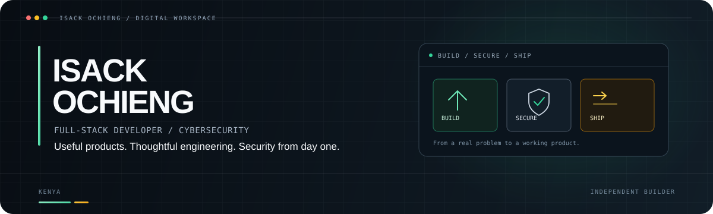

<!-- A compact, visual-first profile: projects first, details when they matter. -->

  

  <a href="https://isack-ochieng.pages.dev">Portfolio</a>
  &nbsp;·&nbsp;
  <a href="https://www.linkedin.com/in/isack-ochieng">LinkedIn</a>
  &nbsp;·&nbsp;
  <a href="https://www.credly.com/users/isack-ochieng-omondi/badges#credly">Verified credentials</a>
  &nbsp;·&nbsp;
  <a href="https://github.com/isack-ochieng">GitHub</a>

I build web and mobile products end-to-end, with a security-first mindset. I care about shipping useful software—and understanding how it can fail before someone else finds out.

## Selected work

<table>
  <tr>
    <td width="50%" valign="top">
      <strong><a href="https://myroomie.site">01 / MY ROOMIE ↗</a></strong>  
      A student roommate-matching product focused on compatibility and better campus living.  
      React · TypeScript · Supabase · Cloudflare · Capacitor 
      <a href="https://play.google.com/store/apps/details?id=site.myroomie.app">Android app</a>
    </td>
    <td width="50%" valign="top">
      <strong><a href="https://miyaratrader.pages.dev/dashboard">02 / MIYARA TRADERS ↗</a></strong>  
      A Deriv-connected trading workspace for market analysis, trade management, and risk-aware automation.  
      React · TypeScript · Supabase · Deriv API · Cloudflare
    </td>
  </tr>
  <tr>
    <td width="50%" valign="top">
      <strong><a href="https://play.google.com/store/apps/details?id=com.mindguard.app">03 / MINDGUARD ↗</a></strong>  
      An Android DNS-filtering app that blocks configured harmful domains without TLS inspection or browsing-content telemetry.  
      Flutter · Dart · Kotlin · Android VPN APIs
    </td>
    <td width="50%" valign="top">
      <strong><a href="https://resu-me-a-job.pages.dev/">04 / RESU-ME-A-JOB ↗</a></strong>  
      A free resume and cover-letter builder with editable AI writing support, live previews, and PDF export.  
      React · TypeScript · Gemini API · Cloudflare
    </td>
  </tr>
</table>

Also building around communities: **[Sauti Ya Jamii Media](https://sautiyajamiimedia.co.ke/)** — *We Amplify Voices.*

## Tools I reach for

  
  
  
  
  
  
  
  

**What I optimise for:** useful over flashy · security from the start · owning the path from idea to deployment.

## Credentials

I maintain **20+ certifications and credentials** across cybersecurity, cloud, data, software, blockchain, and leadership.

## Find me

<a href="https://isack-ochieng.pages.dev">Portfolio</a> · <a href="https://www.linkedin.com/in/isack-ochieng">LinkedIn</a> · <a href="https://github.com/isack-ochieng">GitHub</a>

Built with intention, from Kenya.
